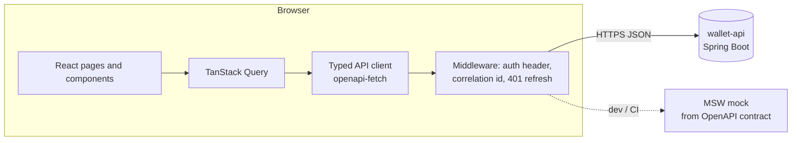

# wallet-dashboard

[](https://github.com/alefsalu/wallet-dashboard/actions/workflows/ci.yml)


Single-page dashboard for a digital wallet. It consumes the [`wallet-api`](https://github.com/alefsalu/wallet-api)
(Java / Spring Boot) through a **typed client generated from its OpenAPI contract**.

The UI scope is small on purpose: login, register, balance, deposit, withdraw, transfer and paginated history.
The engineering is where the depth is: auth with silent refresh, idempotent money operations,
contract-driven mocks and end-to-end tests.

## Highlights

| Concern | How it is solved | Where |
|---|---|---|
| Type-safe API | `openapi-typescript` generates types from `contracts/wallet-api.openapi.yaml`; `openapi-fetch` uses them | `src/types/api.ts`, `src/lib/api-client.ts` |
| Auth | Access token **in memory only**; refresh token rotated on each use; **single-flight refresh** on 401 so N parallel requests trigger one refresh | `src/lib/auth-token-storage.ts`, `src/lib/refresh-queue.test.ts` |
| Idempotency | One `Idempotency-Key` (UUID) per submission, **reused on retry**, so a double click or a network retry never moves money twice | `src/lib/idempotency.ts`, `src/features/operations` |
| Errors | RFC 7807 `problem+json` parsed into UI messages and form field errors | `src/lib/rfc7807.ts` |
| Tracing | `X-Correlation-Id` sent on every request | `src/lib/correlation-id.ts` |
| Validation | Zod schemas shared by forms (money with 2 decimals, max `1000000.00`, same-wallet transfer blocked) | `src/features/operations/schemas` |
| Mocks | MSW handlers built from the contract, used by unit tests, local dev and E2E in CI | `src/mocks` |
| Delivery | Multi-stage Docker image, unprivileged nginx, CSP and security headers | `Dockerfile`, `nginx/default.conf` |

## Architecture



The code is organized **by feature**, not by technical layer:

```
src/
  features/
    auth/          login, register, AuthContext
    dashboard/     balance card, recent transactions
    operations/    deposit, withdraw, transfer (+ Zod schemas)
    transactions/  paginated history
    wallet/        wallet queries, BRL formatting
  lib/             api client, token storage, idempotency, RFC 7807, correlation id
  components/      design-system primitives (Button, Input, Modal, Alert...)
  routes/          router, ProtectedRoute, PublicOnlyRoute
  mocks/           MSW handlers and fixtures
```

More detail in [docs/architecture.md](docs/architecture.md) and the [ADRs](docs/adr).

## Running

Requirements: Node 22+ or Docker.

```bash
npm ci
npm run dev                 # http://localhost:5173 (MSW mocks the API)
```

With Docker (nginx, port 8088):

```bash
docker compose up --build   # http://localhost:8088
```

Against the real API, with `../wallet-api` checked out next to this repo:

```bash
docker compose -f compose.e2e.yml up --build
```

## Testing

```bash
npm test                # Vitest + Testing Library (unit and component)
npm run test:coverage   # coverage report
npm run test:e2e        # Playwright E2E (against the contract mock)
npm run lint
make ci                 # guard + lint + tests
```

## API contract

`contracts/wallet-api.openapi.yaml` is a pinned copy of the `wallet-api` contract. To update it and regenerate types:

```bash
make sync-contract      # copies ../wallet-api/openapi/openapi.yaml
npm run codegen:api
```

## CI/CD

GitHub Actions: guard (blocks private files and secrets) → lint → unit tests → E2E → security scan → image build.
Dependabot keeps npm, Docker and Actions dependencies up to date.

## License

[MIT](LICENSE)
