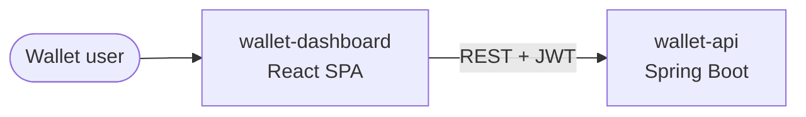
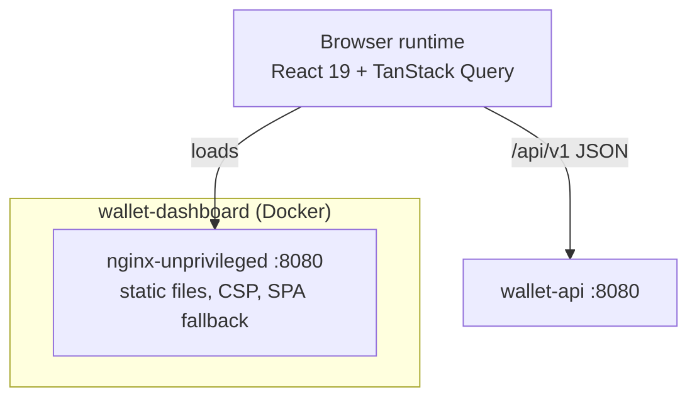
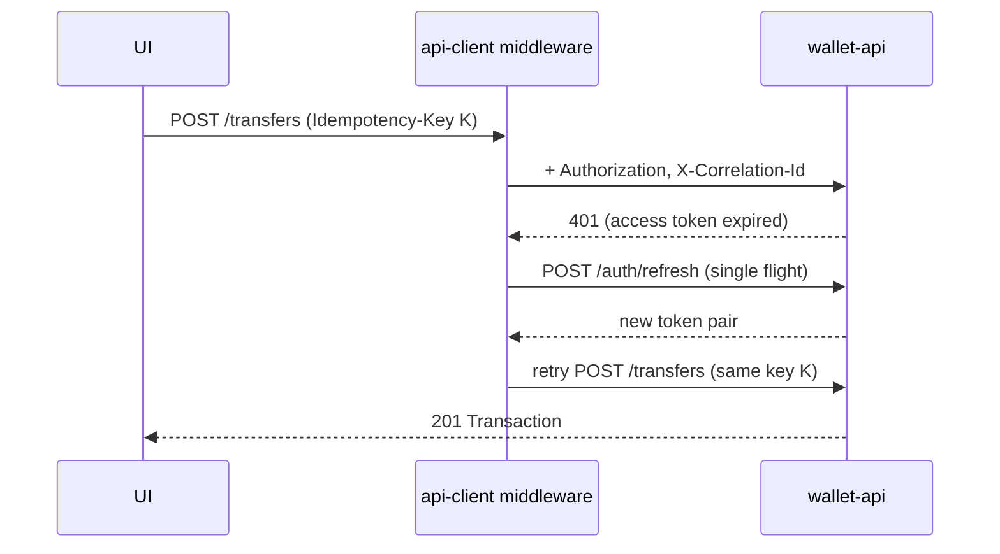

# Architecture

## C4 — Context

## C4 — Container

## Request lifecycle

## Key rules

- The access token lives only in JS memory. The refresh token is persisted so the session survives a page reload, and it is rotated on every use.
- Concurrent 401s share one refresh promise (`createSingleFlightRefresh`).
- Each money operation creates one `Idempotency-Key` when the form is submitted and reuses it on retry.
- Server errors arrive as RFC 7807 and are mapped to UI text and field errors.
